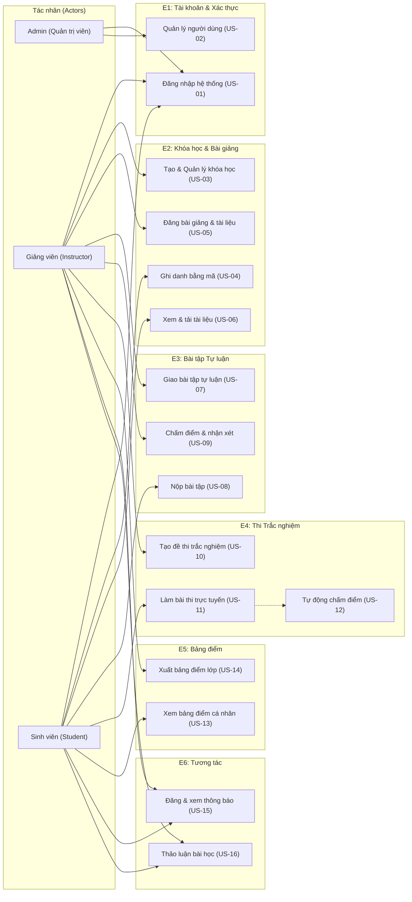
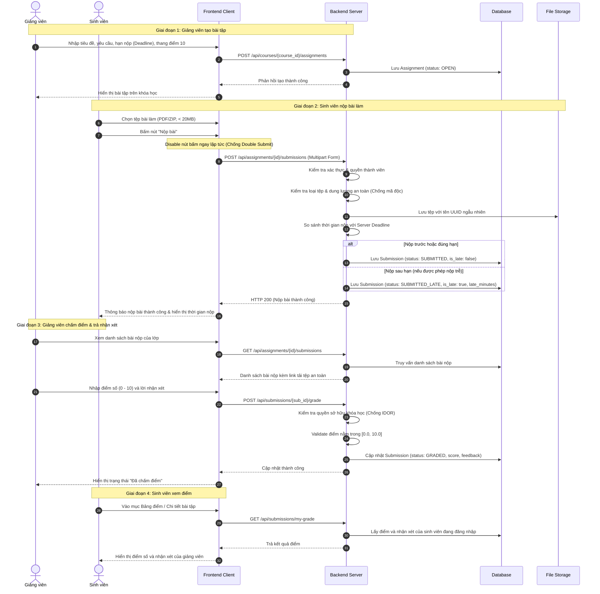
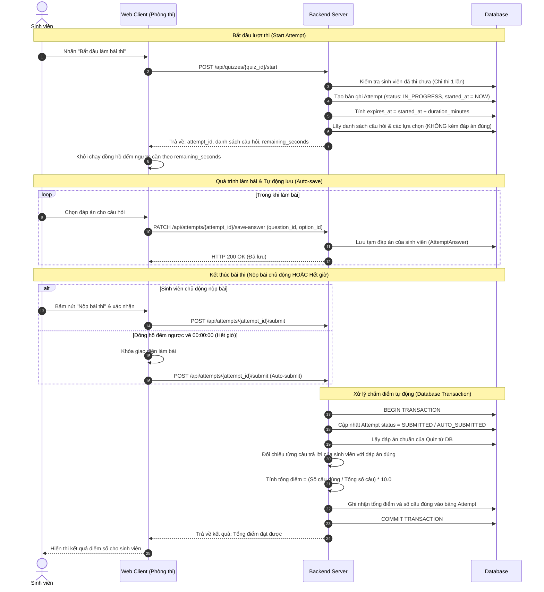
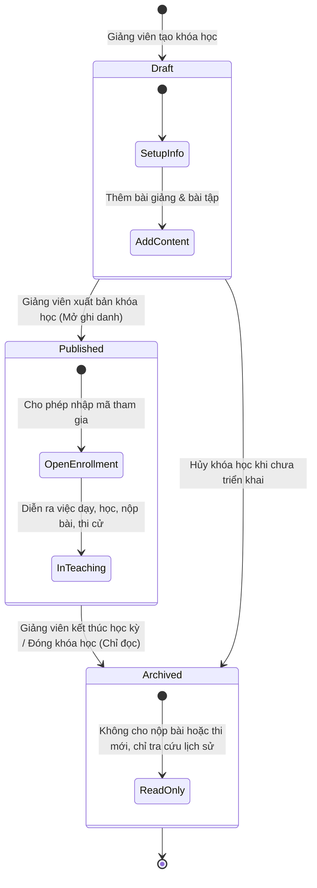
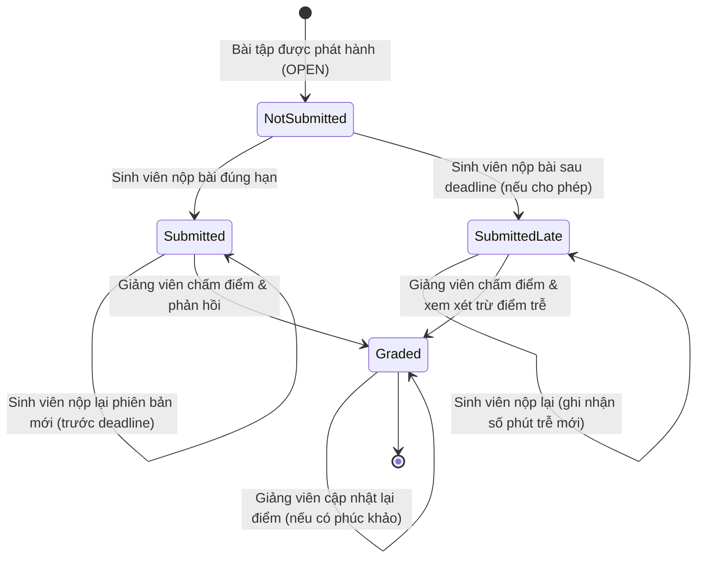
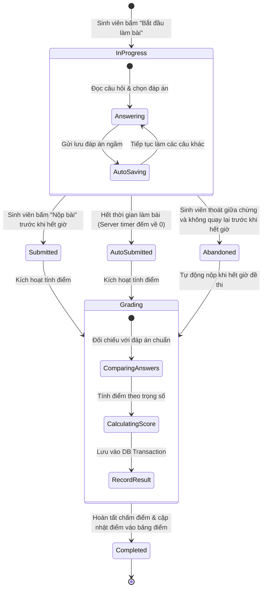

# SƠ ĐỒ LUỒNG NGHIỆP VỤ (BUSINESS FLOWS) - LMS MINI

Tài liệu này mô tả chi tiết các luồng nghiệp vụ của hệ thống LMS Mini dưới dạng sơ đồ Mermaid trực quan, phục vụ việc đối chiếu giữa tài liệu PRD và giai đoạn thiết kế kiến trúc, cơ sở dữ liệu.

---

## 1. Sơ đồ Use Case Tổng quan Hệ thống (System Use Case Flowchart)

Sơ đồ thể hiện sự tương tác của 3 Actor chính (Admin, Giảng viên, Sinh viên) đối với các nhóm chức năng trong hệ thống LMS Mini.

---

## 2. Luồng Nộp bài và Chấm bài Tự luận (Assignment & Grading Flow)

Luồng chi tiết từ khi Giảng viên giao bài tập, Sinh viên nộp tệp bài làm (xử lý trường hợp đúng hạn và trễ hạn, phòng chống double submit), đến khi Giảng viên chấm điểm và Sinh viên xem kết quả.

---

## 3. Luồng Thi Trắc nghiệm và Tự động Chấm điểm (Quiz & Auto-grading Flow)

Luồng chi tiết quá trình làm bài thi trực tuyến: đồng bộ thời gian từ server, auto-save đáp án khi chọn, xử lý nộp bài chủ động hoặc tự động thu bài khi hết giờ, và chấm điểm trong một database transaction.

---

## 4. Các Sơ đồ Trạng thái (State Diagrams)

### 4.1. Sơ đồ Trạng thái Khóa học (Course State Diagram)

---

### 4.2. Sơ đồ Trạng thái Bài nộp Tự luận (Submission State Diagram)

---

### 4.3. Sơ đồ Trạng thái Lượt thi Trắc nghiệm (Quiz Attempt State Diagram)

